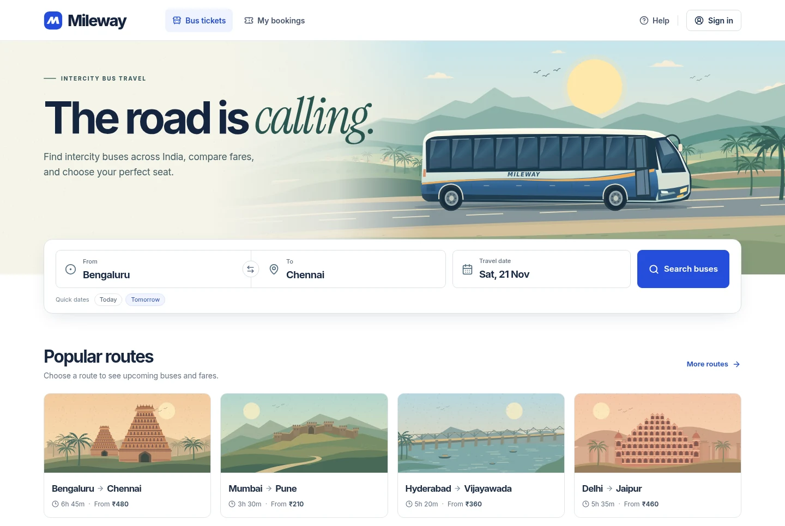

# Mileway

Mileway is a full-stack proof of concept for booking intercity buses in India. Search a dated timetable, choose seats on either deck, enter passenger details, apply a coupon, complete a test payment and download a PDF ticket. The inventory, operator brands and seeded reviews are fictional. Every ticket and refund is for demonstration.



## Run the complete app locally

Use Node.js 22.13+ (22.x) or 24.x with npm. Run these commands from a terminal with about 2 GB of free disk space for dependencies, build files and the development database.

```sh
git clone https://github.com/harshitpandey57/mileway-booking-platform.git
cd mileway-booking-platform
npm ci
npm run demo:local
```

**Windows ZIP setup.** Sign in to GitHub and [download the project ZIP](https://github.com/harshitpandey57/mileway-booking-platform/archive/refs/heads/main.zip). In File Explorer, select **Extract All**, then open the extracted folder containing `package.json` and `package-lock.json`. Type `powershell` in that folder’s address bar and press Enter. Run `npm.cmd ci`, then `npm.cmd run demo:local` after installation succeeds.

Open **http://localhost:4000** when the server prints its listening message. The command starts a real loopback-only MongoDB replica set, builds the application, seeds the database and serves the exported site and API from one process. Its first run downloads an official MongoDB Community binary for your platform. The account data persists under the ignored `.local/` directory. Stop it with Ctrl+C. To use a preinstalled compatible binary, set `MONGOMS_SYSTEM_BINARY` to the absolute path of `mongod`.

Choose **Bengaluru → Chennai**, select **Tomorrow**, then **Search buses**. Select a seat, register your own customer account or sign in, and continue to the passenger form. Choose a boarding and dropping point, then **Review booking → Pay with demo → Simulate success**. The confirmation page has **Download PDF**, **Print** and **Verify ticket**. The demo also supports failure, cancellation and retry while the hold remains active.

| Role | Default sign-in address | Access |
| --- | --- | --- |
| Customer | `customer@mileway.test` | Profile, saved passengers, bookings, tickets, cancellation and support |
| Operator | `operator1@mileway.test` | Own buses, routes, departures, fares, cancellation rules, manifests and revenue |
| Administrator | `admin@mileway.test` | Platform analytics, accounts, operators, fleet, departures, payments, refunds, coupons, reviews, support and audit history |

The local shortcut generates the initial seed password in **`.local/demo.env`**. With manual setup, the initial password is the value you set for `DEMO_SEED_PASSWORD`. Ten operator accounts are available, numbered 1–10. Reseeding preserves existing passwords. Seeded accounts share the initial passphrase, so keep it private and use registered customer accounts for visitors. The account menu links each staff member to the appropriate dashboard.

## Repository and stack

```text
apps/web/
  app/                 Next.js App Router pages, static export and metadata
  components/          Site navigation, providers and shadcn/ui primitives
  features/            Home, booking, account and staff interfaces
  lib/                 Typed API client and session context
  public/              Original travel illustrations and font assets
apps/api/
  src/config/          Database, environment and static-site configuration
  src/core/            User and support models, authentication and authorization
  src/catalog/         Cities, stations, operators, buses, routes, trips and reviews
  src/reservations/    Seat inventory, holds, passengers, bookings, payments and tickets
  src/management/      Authorized staff queries, mutations, manifests and analytics
  src/middleware/      Consistent HTTP error responses
  src/routes/          OpenAPI specification
  src/seed/            Repeatable fictional fixtures
  src/server.ts        Single-service startup and graceful shutdown
packages/shared/       Shared TypeScript types, constants and Zod schemas
tests/                 API integration suites and desktop/mobile Playwright scenarios
scripts/               Local replica set, one-command demo and isolated E2E server
docs/                  Catalog, search and fixture details
render.yaml            Free web service blueprint
```

The web application uses React, TypeScript, Tailwind CSS, shadcn/ui, Lucide, TanStack Query, React Hook Form, Zod and Sonner. Responsive screens read their journey, hold and booking identifiers from query parameters. Express serves the static page directory, real 404 responses, Swagger UI and the versioned JSON API. MongoDB and Mongoose provide persistence. PDFKit and QRCode generate tickets in memory. The site’s locally bundled illustrations and fonts do not need an image or font API.

## Manual environment setup and development

Copy `.env.example` to `.env` at the repository root. The Node scripts load it. Generate independent values for the JWT signing secret and initial seed password. The following prints a new random value each time it is run.

```sh
cp .env.example .env
node -e "console.log(require('node:crypto').randomBytes(32).toString('hex'))"
```

| Variable | Configuration |
| --- | --- |
| `MONGODB_URI` | Atlas connection string including a database name, or the local replica-set URI from `npm run db:local` |
| `JWT_SECRET` | Random secret of at least 32 bytes, stored only on the API service |
| `DEMO_SEED_PASSWORD` | Private initial passphrase for demo accounts, at least 12 characters and at most 72 UTF-8 bytes |
| `DEMO_SEED_EMAIL_DOMAIN` | Optional account domain for a fresh database. The default is `mileway.test` |
| `PORT` | API and exported site port. Local default 4000. Render supplies its own value |
| `PUBLIC_BASE_URL` | Public origin for QR verification and password-reset links. Local default `http://localhost:4000`. Render defaults to `RENDER_EXTERNAL_URL` |
| `WEB_ORIGIN` | Optional trusted browser origin for split-origin development. Default in the example is `http://localhost:3000` |
| `NODE_ENV` | Use `development` locally and `production` on the hosted HTTPS service. Production uses secure cookies |
| `APP_ENV`, `DEMO_PAYMENTS` | To enable the simulated checkout, explicitly set `APP_ENV` to `development`, `test` or `demo`, and `DEMO_PAYMENTS=true` |
| `SEED_ON_START` | Set to `true` to extend the demonstration timetable when starting the server. Default is off unless set |
| `RAZORPAY_KEY_ID`, `RAZORPAY_KEY_SECRET`, `RAZORPAY_WEBHOOK_SECRET` | Supply all three for Razorpay Test Mode. The server requires an `rzp_test_` key |
| `RESEND_API_KEY`, `MAIL_FROM` | Optional HTTPS password-reset delivery. Configure a verified sender for delivery to other users |
| `SMTP_URL`, `MAIL_FROM` | Optional alternative email transport on hosts that permit SMTP |
| `ALLOW_DEV_RESET_LOG` | With email unconfigured, opt in to server-console reset links in development. Production ignores this option |
| `NEXT_PUBLIC_API_ORIGIN` | Optional browser-visible API **origin** for split hosting. Leave unset for the single-service export. The dev browser client defaults to `http://localhost:4000` |

For a local database, start `npm run db:local` in its own terminal. Alternatively, create an Atlas **Free / M0** cluster, add a database user with `readWrite` on a dedicated `mileway` database, add your client IP to Network Access and copy **Connect → Drivers** into `MONGODB_URI`. Percent-encode credentials containing reserved URI characters. Include the database name before the query string, for example `mongodb+srv://<user>:<password>@<cluster>/mileway?retryWrites=true&w=majority`. Use an Atlas replica set or a local replica set for transactions.

```sh
npm ci
npm run build -w @mileway/shared
npm run seed
npm run dev
```

Open **http://localhost:3000** for Next development and **http://localhost:4000/api/health** for database readiness. Set `PUBLIC_BASE_URL=http://localhost:3000` while testing QR and reset links against the development UI. If changing the development API origin, set `NEXT_PUBLIC_API_ORIGIN` in the web process environment or `apps/web/.env.local`, then restart Next. To exercise the same single-service layout as Render, set `PUBLIC_BASE_URL=http://localhost:4000` and run `npm run build && npm start`.

## Booking and payment behavior

- A seat has a unique `(tripId, seat)` inventory entry. A transaction checks the current trip and atomically acquires all seats in the request. A hold expires after ten minutes or at departure, whichever comes first. Reads and writes evaluate timestamps directly. A periodic MongoDB TTL cleanup removes obsolete cart records.
- The seat price, coupon eligibility, discount cap, chosen stops and one-to-one seat/passenger assignment are checked on the server. Monetary values stored by the app are whole INR. Razorpay order amounts and captured amounts use integer paise. A zero-total coupon booking is settled internally.
- A pending booking retains its fare and policy snapshot. The backend creates or reuses its payment order. It verifies the checkout signature against the stored gateway order and fetches capture status from Razorpay. Webhook signatures use the exact raw request bytes and a separate secret.
- Confirmation, inventory assignment and payment updates share a transaction. Duplicate capture notifications are idempotent. A late capture that cannot claim its seats creates a full simulated refund record. A failed payment can be retried during the hold.
- Customers can cancel within the saved policy window. The system releases the seats, stores the simulated refund amount and updates ticket verification. The public QR response omits passenger names and contact details. PDF access requires the booking owner’s session. Nine Indian scripts have bundled PDF font coverage. [Ticket and font details](docs/tickets.md)
- Passwords are bcrypt-hashed. The API checks the current role, active status and token version with each authenticated request. HTTP-only cookies, origin and JSON-write checks, input validation, request throttling, Helmet headers, scoped queries and staff audit events protect the application. The client receives only the Razorpay test key ID.

## Razorpay and email

1. Select **Test Mode** in your Razorpay dashboard, generate a test key pair and set both Razorpay key variables on the API service.
2. Enable **automatic capture**. Add a test webhook at `https://<your-service>/api/v1/payments/webhook` for `payment.captured` and `payment.failed`. Generate a separate webhook secret and set `RAZORPAY_WEBHOOK_SECRET` to the same value.
3. Restart the service and use Razorpay’s published test payment methods in checkout. Configured test keys take precedence over simulated payments. A public HTTPS service is needed for gateway-delivered webhooks.

### Password-reset email in the VS Code demo

By default, request a reset with an email registered in this copy of Mileway and look for `[Mileway development mailbox]` in the terminal running the server. Open the latest link within 15 minutes. The seeded `@mileway.test` addresses are fictional.

To receive mail in your own inbox, register a Mileway customer with the same email address you use for your Resend account. Create a sending API key in Resend. In the project folder alongside `package.json`, create or edit the file named `.env` and enter the two settings below. Replace the placeholder with your key and keep this file private.

```dotenv
RESEND_API_KEY=your_resend_sending_key
MAIL_FROM=onboarding@resend.dev
```

Stop the demo with **Ctrl+C**, restart it with `npm.cmd run demo:local` in PowerShell, then request a new link under **Sign in → Forgot password?** Open a localhost reset link on the computer running Mileway. The Resend onboarding sender can deliver to the Resend account’s own email address. To send to other inboxes, verify a domain in Resend and set `MAIL_FROM` to a sender on that domain.

The local demo reads `RESEND_API_KEY`, `SMTP_URL` and `MAIL_FROM` from the root `.env`. Terminal environment variables take precedence. Resend takes precedence over SMTP. On Render Free, configure the Resend settings in the service environment. If an expected email is missing, check the server terminal for a transport error, then check the provider’s sending logs and the recipient’s spam folder.

[Razorpay test payments](https://razorpay.com/docs/payments/payments/test-card-details/) · [Razorpay webhook setup](https://razorpay.com/docs/webhooks/setup-edit-payments/) · [Resend sender restrictions](https://resend.com/docs/knowledge-base/403-error-resend-dev-domain)

## API and tests

When running, open **/api/docs/** for interactive Swagger documentation and **/api/openapi.json** for OpenAPI 3.0.3. **/api/health** returns HTTP 200 with `database: connected` once MongoDB is ready. JSON successes use `data`, and list endpoints identify their pagination. Errors include `error.message`. Browse the public inventory without a session. In Swagger, use **POST /auth/login** before calling protected routes on the same origin.

```sh
npm run lint
npm run typecheck
npm run build
npm run test:api
npx playwright install chromium
npm run test:e2e
```

The API suites create fresh random databases on a disposable local replica set by default. To reuse a dedicated local test replica set, set `TEST_MONGODB_URI` and grant permission to create and drop isolated test databases. Each suite removes only its own database. Playwright starts a separate test database and an Express service with the exported Next build. It tests registration in the booking flow, a payment failure and retry, PDF bytes, public verification, fresh-session history and cancellation, plus staff operations on desktop and mobile. The mobile project emulates a Pixel 7 in Chromium. Set `PLAYWRIGHT_CHROMIUM_EXECUTABLE` to an installed compatible Chromium if needed. Linux runners may need `npx playwright install --with-deps chromium`.

Search examples, fixture counts, fare units, time windows, review eligibility and rolling seed behavior are documented separately. [Catalog guide](docs/catalog.md)

## Verification record

The production export and Express startup were exercised with MongoDB Community 7.0.32 in replica-set mode. All 30 API integration tests and all six Playwright tests passed. The browser tests ran the complete simulated booking flow and staff operations at desktop and mobile sizes. A clean clone installed with npm ci and started with npm run demo:local. Its health endpoint connected to MongoDB, all three demo roles signed in and the Bengaluru to Chennai search returned six departures for tomorrow. TypeScript checks and ESLint passed. The Render blueprint was validated against Render’s published JSON Schema.

Razorpay callbacks and webhook replays were tested with signed fixtures and mocked gateway responses. HTTPS email delivery used a mocked transport. An externally hosted Atlas connection, Render deployment, mail delivery and a merchant’s Razorpay Test Mode checkout require the owner’s service configuration.

## Deploy one free Render web service

1. Use this GitHub repository or a fork containing the entire monorepo, including `package-lock.json` and `render.yaml`.
2. Create the free Atlas cluster and database user described above. In Render choose **New → Blueprint**, authorize access to the GitHub repository and select the branch. The blueprint requests one free Node web service.
3. Enter `MONGODB_URI` and a strong private `DEMO_SEED_PASSWORD` when prompted. Render generates `JWT_SECRET`. The service defaults to its assigned HTTPS URL for ticket and reset links. For a custom domain, configure `PUBLIC_BASE_URL` yourself.
4. From the Render service’s **Connect → Outbound** panel, add the service’s published outbound IP ranges to the Atlas network access list. If the initial service startup ran before the allowlist was ready, redeploy after adding those ranges.
5. The build command is `npm ci --include=dev && npm run build`. The start command is `npm start`. Express listens on `0.0.0.0` and Render’s `PORT`. The blueprint seeds on startup. Leave `NEXT_PUBLIC_API_ORIGIN` unset. No dedicated database, background worker, cron service or disk on Render is required.
6. After deployment, open **/api/health**, then test tomorrow’s Bengaluru → Chennai search, a customer booking and a PDF download. For gateway testing add the Razorpay keys and webhook. The blueprint explicitly enables simulated checkout under `APP_ENV=demo`. Set `DEMO_PAYMENTS=false` when demonstrating the gateway exclusively.

Render Free offers 0.1 CPU and 512 MB RAM per web service, spins down after about 15 minutes without inbound traffic, and can take about a minute to wake. A workspace shares 750 free instance hours per calendar month. Build minutes and transfer are also quota-limited. Instance storage is ephemeral and free services block common SMTP ports. Atlas Free has a 0.5 GB storage limit. Keep the demo dataset small and check each provider’s current allowances. The project uses on-demand requests and no paid keep-alive service. [Render Free](https://render.com/docs/free) · [Atlas Free limits](https://www.mongodb.com/docs/atlas/reference/free-shared-limitations/)

## Troubleshooting and operational limits

| Symptom | Check |
| --- | --- |
| Startup cannot select a MongoDB server | Atlas IP allowlist, database username, encoded password, database name, cluster status and DNS. Confirm a local database is a replica set |
| No buses appear | Use the next two weeks in India time. Rerun `npm run seed` to extend the demo calendar. A past departure is closed |
| Seat conflict or hold expiry | Refresh the seat map and select available seats again. The first commit wins. The server resolves expiry even during a cold start |
| Payment order unavailable | Configure all gateway variables, or opt into the simulator using both demo settings. Check that a pending booking still has an active hold |
| Ticket QR opens the wrong site | Set the externally reachable `PUBLIC_BASE_URL`, restart, and download the PDF again |
| Session or API requests fail in dev | Use a consistent hostname, set `WEB_ORIGIN` to the frontend origin, and use HTTPS with `NODE_ENV=production` |
| MongoDB test binary download fails | Use `MONGOMS_SYSTEM_BINARY` or a supported OS/architecture. An existing local replica set also works for API tests |
| Password reset reports unavailable | Configure HTTPS email, supported SMTP or the explicit local mailbox option. For HTTPS delivery use a valid sender and check provider logs |

This POC implements fictional schedules and test payments. Refunds are simulated. A public commercial launch would require operator agreements and live inventory reconciliation, production payment onboarding and real refund reconciliation, deployment capacity and monitoring, retention and backup policies, tested email delivery, privacy review and operational support. Seeded history grows as the timetable advances. Establish archival and retention rules before sustained use. In-memory rate limits suit the single web service; distributed deployment requires a shared rate-limit store.

The original artwork and Mileway branding were created for this project. Instrument Serif’s license is bundled under `apps/web/public/fonts`. Inter is supplied by `@fontsource-variable/inter` with its SIL Open Font License.
